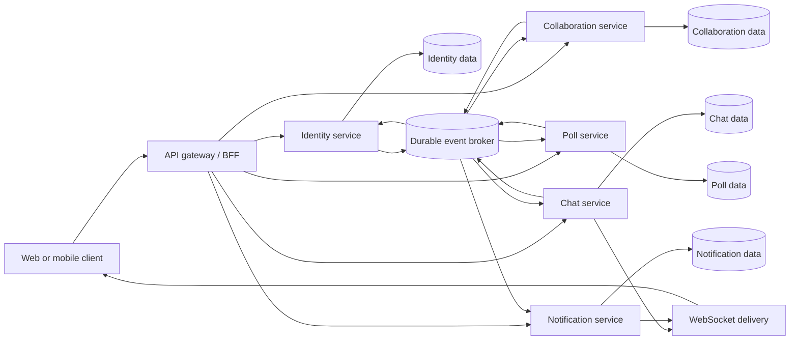

# ADR: Domain-Oriented Services for Teamify

- **Status:** Accepted for the design exercise; production commitment requires validation of the open questions below
- **Date:** 2026-10-27
- **Decision owners:** Teamify project stakeholders (to be confirmed)
- **Related material:** [Task 1 architecture proposals](./Task_1_Architecture_Notes.md)

## Context

Teamify supports account creation and management, personal task agendas, teams and member roles, shared events and invitations, polls and voting, group chat, and notifications. The system must keep personal tasks private and enforce team membership and administrator permissions on shared operations. The notification center must retain notifications beyond a live connection, and users need to retrieve chat history when reconnecting.

The requirements describe capabilities, but do not define expected traffic, team size, deployment platform, availability targets, team ownership, or retention rules. This ADR chooses the domain-oriented services proposal from Task 1 as the target architecture for this design exercise. The choice is not evidence that the services are required at production launch; the operational and consistency costs are significant and must be justified against measured needs.

## Decision drivers

1. Keep identity, collaboration, chat, polls, and notification data ownership explicit.
2. Reduce accidental data exposure by limiting each service to the data and operations it owns.
3. Make service behavior independently testable, with explicit API and event contracts between domains.
4. Allow chat fan-out and notification delivery to scale or fail independently from task and event operations.
5. Enforce ownership and current team permissions at the service that handles each operation.
6. Support reliable asynchronous notifications and cross-service updates without pretending distributed transactions are atomic.
7. Make the costs of independent deployment, data consistency, and operations visible rather than hiding them behind a diagram.

## Decision

Implement Teamify as domain-oriented services behind an API gateway or backend-for-frontend. Each service owns its data and exposes documented APIs and versioned domain events. Services do not read or write another service's database.

Use synchronous APIs for operations that need an immediate authoritative answer, including membership/role authorization. Use a durable message broker for side effects and projections that can be eventually consistent. Each service that publishes events uses a transactional outbox: the business change and outbox record commit together, then a publisher forwards the record to the broker. Consumers are idempotent and track processed event IDs.

No cloud provider, programming language, database vendor, or broker is selected by this ADR. A relational database is the initial default for services with relational data and transactional constraints, but each service chooses and owns its own schema/storage based on its access patterns.

### Data isolation and testability rationale

The service boundaries are intended to reduce accidental data leakage: a service should access its own datastore and expose only deliberate API operations or events to other services. This is a containment mechanism, not a security guarantee. It only works when datastore credentials and network access are scoped per service, APIs enforce authentication and resource-level authorization, and event payloads contain no unnecessary personal data. A compromised or over-privileged service, an overly broad API, or an incorrectly scoped query can still expose information.

The same boundaries can make testing more focused: domain rules can be unit-tested within the owning service, while API and event contracts can be tested independently. Cross-service behavior still needs contract tests, integration tests with the broker and persistence layer, and end-to-end tests for sensitive workflows such as membership revocation and account deletion. More services mean more boundaries and failure modes to test; independent deployment does not make the entire system easier to test automatically.

## Service boundaries and ownership

| Component | Owns | Does not own |
|---|---|---|
| API gateway / backend-for-frontend | Client-facing routing, request shaping, rate limits, authentication-token validation, and response composition | Domain authorization decisions or authoritative business data |
| Identity | Accounts, credentials or identity-provider integration, profile data, sessions, password reset, and account lifecycle | Team membership, team roles, or domain resources |
| Collaboration | Teams, membership and administrator roles, personal tasks, shared events, invitations, and agenda queries | Credentials, chat history, poll votes, or notification delivery |
| Chat | Team conversations, durable messages, history pagination, and message metadata | Team membership authority or notification inbox |
| Polls | Poll definitions, eligibility snapshots/rules, votes, and results | Team roles or notification delivery |
| Notifications | Durable in-app notification records, read state, delivery preferences, and delivery attempts | The business records that caused a notification |
| Message broker | Durable transport of versioned domain events and queued work | The authoritative source of business state |

The gateway may validate that a token is authentic and identify its subject, but it does not grant access based on stale team-role claims. Collaboration is authoritative for membership and roles. Services enforce resource-level authorization; the gateway is not a substitute for service checks.

## Logical architecture

The diagram shows logical ownership and communication, not a required number of database servers or deployment clusters. Each service may scale independently, but doing so requires deployment automation, monitoring, and operational ownership.

## Communication and consistency

- **Synchronous request/response:** Use service APIs when a client needs a definitive result, for example creating a task, changing a role, submitting a vote, or checking a caller's membership before sending a chat message.
- **Asynchronous events:** Publish facts such as `TeamMemberRoleChanged`, `TeamDeleted`, `EventInvitationCreated`, `EventResponseChanged`, `PollClosed`, and `ChatMessageCreated`. Events carry a stable event ID, schema version, entity ID, and enough context for consumers to act without reading another service's database.
- **At-least-once delivery:** Assume events can be duplicated, delayed, or observed out of order. Consumers deduplicate by event ID, apply entity versions where order matters, retry transient failures, and send poison messages to an observable dead-letter path for investigation and replay.
- **Read composition:** A team overview or combined agenda may require API composition or a purpose-built read model. Results can be partially unavailable or stale; APIs must not silently present partial data as complete.
- **No distributed transaction:** A successful local write is authoritative in its owning service. Dependent work may remain pending until events are processed. APIs and user experience must represent this state where it matters.

## Critical authorization boundary: membership and chat

Collaboration is the source of truth for team membership and roles. Before accepting a chat send, Chat makes an authenticated internal authorization request to Collaboration using the user and team IDs. Chat must fail closed if it cannot establish authorization. Membership projections can support fan-out or display, but must not be used to authorize a new message.

This design favors immediate authoritative checks over cached-role speed, at the cost of latency and a runtime dependency on Collaboration. It cannot provide a cross-service atomic transaction between the membership check and message persistence: a member could be removed in the small interval between the check and the write. If requirements demand strict, instantaneous revocation with no such race, reconsider this boundary—for example, co-locate membership enforcement with message writes or add a carefully designed revocation/version protocol. Do not claim that asynchronous role-change events alone guarantee immediate revocation.

Other protected actions follow the same principle: Collaboration validates administrator rights for team, event, and invitation changes; Polls validates poll eligibility and obtains the relevant role/eligibility decision from Collaboration where needed. Identity tokens identify the caller but are not proof of current team membership.

## Example workflow: creating a shared event

1. The client submits an event and invitee list through the gateway.
2. Collaboration validates the caller's identity and current administrator role, and checks that invitees are members of the team.
3. In a local transaction, Collaboration creates the event and invitations and writes corresponding outbox entries.
4. Its outbox publisher emits versioned invitation events. Notifications consumes them and persists in-app notification records before attempting WebSocket, email, or push delivery.
5. A delivery failure does not roll back the event or lose the notification. Retry and reconnect behavior operate on durable records.
6. Each invitee's acceptance or refusal is a new Collaboration command, authorized and persisted by Collaboration, which publishes a response event for interested consumers.

## Cross-service lifecycle workflows

Team deletion and account deletion span multiple data owners and are implemented as explicit, idempotent workflows rather than a single transaction.

- **Team deletion:** Collaboration marks a team as deleting and prevents new operations, then emits `TeamDeletionStarted`. Chat, Polls, and Notifications revoke access or apply the agreed retention/deletion policy and acknowledge completion. Collaboration records progress and marks deletion complete only after required steps finish. Retries and a repair path handle failed consumers. Define whether historical records are deleted, anonymized, or retained before implementation.
- **Account deletion:** Identity disables authentication and starts the workflow. Each domain service applies the approved retention policy to that user's data and acknowledges completion. Revoke active sessions promptly. The user-facing response distinguishes request accepted from deletion fully completed.

These are saga-style workflows with observable intermediate states; they are not atomic. Retention, legal holds, ownership transfer when the last administrator leaves, and behavior on permanent downstream failure remain product decisions.

## Operational and security requirements

- Authenticate service-to-service calls and use least-privilege credentials. Public clients must never receive broker or database credentials.
- Enforce tenant/team scoping and ownership in every service query and mutation. Validate input, rate-limit sensitive operations, and audit administrator and lifecycle actions.
- Store credentials with a suitable identity provider or modern password hashing; use short-lived, single-use password reset tokens and revoke sessions on relevant credential changes.
- Protect sensitive data in transit and at rest. Define secret rotation, backup, restore, retention, and deletion procedures.
- Propagate correlation/trace IDs across synchronous calls and broker messages. Monitor API latency/errors, broker lag, retries, dead-letter counts, WebSocket delivery, and saga progress.
- Set bounded retries with backoff and jitter; ensure retries cannot create duplicate messages, votes, notifications, or invitations. Provide safe event replay and operational runbooks.
- WebSocket delivery is best-effort live transport, not durable chat or notification storage. Clients reconnect and fetch history/inbox from the owning service.
- Define availability and timeout budgets. Because membership checks are synchronous, Collaboration availability affects Chat message writes; do not hide this dependency with an insecure fallback.

## Consequences

### Benefits

- Chat and notification workloads can scale and deploy independently from task/event operations.
- Service-owned data and APIs provide clear ownership and reduce accidental cross-domain database coupling.
- Failures can be isolated, and async consumers can recover from temporary outages through durable queues and replay.
- The architecture leaves room for domain-specific storage and independent team ownership as the product grows.

### Costs and risks

- The system has more components to deploy, secure, monitor, test, and support than a modular monolith.
- Cross-service workflows add eventual consistency, partial failure, retries, duplicate/out-of-order events, and user-visible pending states.
- Synchronous membership checks add latency and create a Collaboration availability dependency for chat and other protected operations.
- Aggregated screens need API composition or read models and must handle stale or incomplete responses.
- Local development, contract testing, schema evolution, observability, incident response, and infrastructure automation require deliberate investment.
- For unknown or modest scale, these costs may outweigh independent scaling. The Task 1 comparison therefore recommended beginning with a modular monolith unless scale or ownership evidence justifies this decision.

## Alternatives considered

| Alternative | Why not selected for this ADR | Reconsider when |
|---|---|---|
| Modular monolith | Less operational overhead and simpler transactions, but not the selected target for this exercise, which prioritizes explicit service ownership and independent scaling boundaries. It remains the lower-risk launch option given currently unknown scale. | Traffic and workload characteristics are unknown, the team is small, or service operations are not yet mature. |
| Managed serverless/event-driven backend | Can reduce server management and absorb bursty demand, but the cloud provider, hosting constraints, and data access patterns are unspecified. Serverless is also a deployment model that could host some services, not necessarily a competing domain decomposition. | A provider is selected, managed services fit the data and WebSocket needs, and quotas/costs are validated. |

## Rollout and validation

Before production implementation:

1. Confirm service ownership, product retention rules, expected scale, availability targets, and client platforms.
2. Define API contracts, event schemas/versioning policy, authorization behavior, and error semantics.
3. Build a vertical slice spanning Collaboration, broker/outbox, and Notifications; test duplicate delivery, consumer outage/replay, and deletion workflow recovery.
4. Prove chat authorization and revocation behavior under concurrent role change and message send; document the accepted race or revise the boundary.
5. Load-test agenda reads, chat writes/fan-out, and notification delivery. Compare service-operational costs against a modular-monolith baseline.
6. Establish deployment automation, infrastructure-as-code, tracing, dashboards, alerts, backups, and runbooks before expanding service count.

## Open questions

1. What are expected active users, team sizes, message volume, and peak concurrency?
2. What latency and availability targets apply to chat sends, agenda operations, and notifications?
3. Are web, iOS, Android, or all clients required? Are email and push notifications in scope?
4. What is the required membership-revocation guarantee for chat and other team data?
5. What are retention and deletion rules for messages, votes, events, and audit records after account or team deletion?
6. What happens when the final team administrator leaves, loses access, or deletes their account?
7. Which cloud, data residency, privacy, and compliance constraints apply?
