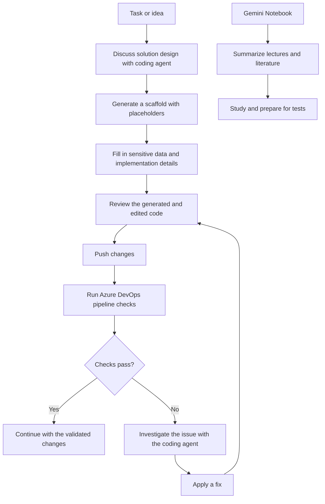

# My Typical Workflow with LLMs

## Tools I Use

For most of my tasks, I use coding agents. My employer provides a Claude
subscription, which I use as a coding assistant in VS Code or IntelliJ IDEA.
For educational work, I use GitHub Copilot.

The web-based model I use is Google Gemini. I particularly like Gemini
Notebook because it lets me provide explicit context for a conversation. I
often use it to summarize lectures and literature when studying or preparing
for tests.

## How I Work with Coding Agents

I try not to rely on “vibe coding” for an entire task. I first discuss the
solution design with the agent. Then I ask it to create a basic scaffold with
placeholders for sensitive data or implementation details, which I fill in
myself.

After making changes, I push them so they can be checked by the live pipeline
in Azure DevOps (similar to GitHub Actions). If a check fails, I work with the
agent iteratively to identify and fix the problem.

I do not usually ask multiple agents to verify one another’s work. My
background in data analysis and Python backend development helps me critically
review generated code, so I do not feel that I need a fully automated agentic
network. I also remain cautious about trusting AI, even though it makes my
work much easier.

## Workflow Diagram

